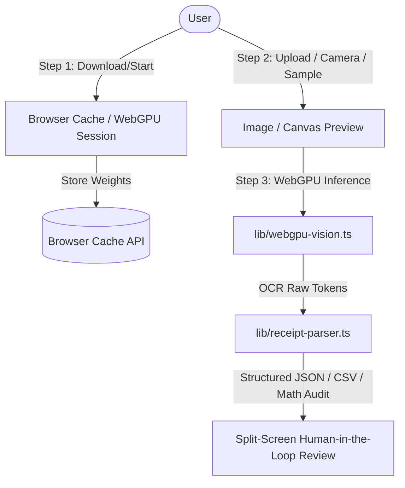

# Receipt AI — In-Browser WebGPU Vision Scanner

> **Demo created by Osama Alam.**  
> For business inquiries, custom AI vision architectures, or enterprise implementations, please contact:  
> 🌐 **[https://www.osamamaalam.com](https://www.osamamaalam.com)**

---

A private, client-side receipt and invoice data extractor powered by WebGPU and in-browser AI vision models. **100% serverless, zero external API costs, and deployable as a static site on GitHub Pages.**

---

## ⚡ Features

- **🚀 WebGPU Hardware Acceleration**: Runs AI vision inference locally inside your browser with automatic CPU/WASM fallback.
- **🔒 100% Private**: Your receipt photos and financial documents never leave your browser or device.
- **💾 Browser Storage Caching**: Model weights (~48 MB) are cached locally in the browser Cache API / IndexedDB. Repeat visits initialize immediately without re-downloading.
- **📄 Interactive 3-Step Demo**:
  1. **Download & Start Model**: Real-time download progress bar and WebGPU shader pre-warming.
  2. **Upload Receipt**: Drag & drop, camera capture, file upload, or 1-click test samples (Arabic & English tax invoices).
  3. **Extract & Side-by-Side Review**: Structured breakdown of Store/Vendor, Date, Subtotal, VAT (rate & amount), Total, and Currency with live in-place editing.
- **🧮 Mathematical Reconciliation Audit**: Automatically checks that `Subtotal + Taxes = Total`, displaying a green verified badge or discrepancy notice.
- **🏷️ Automated Expense Categorization**: Classifies receipts into corporate tax buckets (*Software & Subscriptions*, *Office & IT*, *Travel*, *Meals*).
- **💾 Direct File Downloads**: Instant 1-click downloads for Excel-ready **`.CSV`** (UTF-8 BOM encoded for Arabic support) and **`.JSON`**.
- **🌐 Static GitHub Pages Ready**: Built with `output: 'export'`, single-threaded WASM fallback for environments without COOP/COEP headers, and automated GitHub Actions deployment.

---

## 🏗️ Architecture



---

## 🚀 Getting Started

### Local Development
```bash
# Install dependencies
npm install --legacy-peer-deps

# Start development server
npm run dev
```
Open [http://localhost:3000](http://localhost:3000) to view the demo.

### Static Build (for GitHub Pages / Static Hosting)
```bash
npm run build
```
The static website is exported to the `out/` directory, ready to deploy to GitHub Pages, Cloudflare Pages, Netlify, or Vercel.

---

## 📦 GitHub Pages Deployment

The automated workflow is configured at [`.github/workflows/pages.yml`](.github/workflows/pages.yml):
1. Push to `main` or `master`.
2. In your GitHub repository settings, go to **Settings > Pages > Build and deployment > Source** and select **GitHub Actions**.
3. Your static WebGPU receipt scanner will be live at `https://<username>.github.io/<repo>/`!

---

## 👨‍💻 Creator & Business Inquiries

This project and demo was architected and built by **Osama Alam**.

If you are looking for:
- Bespoke on-device AI & WebGPU computer vision pipelines
- Edge document intelligence & invoice digitization
- Custom SaaS architectures and frontend performance engineering

Please submit your inquiry via:  
👉 **[https://www.osamamaalam.com](https://www.osamamaalam.com)**
